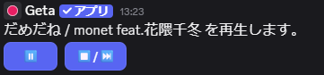
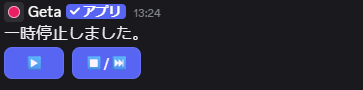

# GetaBot

Play Youtube on Discord.


## How to use

### 必要なもの

- GetaBot本体 ([ダウンロード](https://www.python.org/downloads/))

- Pythonが実行できる環境 ([インストール](https://www.python.org/downloads/))
  - pipが実行できる環境（ライブラリーをインストールしていない場合）

- ffmpeg（[インストール](https://github.com/BtbN/FFmpeg-Builds/releases/tag/latest)）

- deno（[インストール](https://deno.land/)）

- BOT TOKEN（[ここ](https://discord.com/developers/applications)からアプリケーションを作成し、BOTタブからTOKENを取得してください。

- cookies.txt（年齢制限が必要な動画を再生する場合。取得は各自で行ってください）

### 手順

1. Getabot.py , SEフォルダー , [ffmpeg](https://github.com/BtbN/FFmpeg-Builds/releases/tag/latest) , [deno](https://deno.land/)をダウンロード・インストールし、同一ディレクトリに配置してください。  
(ffmpegはbinフォルダー内のexeファイルのみ配置で大丈夫です。)  

#### ディレクトリ

```
/
|- gatabot.py
|
|- ffmpeg.exe
|- ffprove.exe
|
|- deno.exe
|
|- runbot.bat
|
|- (Cookies.txt)
```

1. 以下のライブラリーをインストールしてください。  
(インストール済みの場合はインストール不要です。3に進んでください。)

```python
pip install -U discord
```

```python
pip install -U discord.py[voice]
```

```python
pip install -U "discord.py[voice]" davey
```

```python
pip install -U yt-dlp
```

```python
pip install -U ffmpeg-python
```  

Python3.13を使用している場合

```python
pip install -U audioop-lts
```

1. トークンを入力して実行

```Python
～～～～～　省略　～～～～～
###Commands End###
client.run("YourTokenHere") ←ここに取得したTOKENを貼り付けてください。
```

コンソールに

```Bash
Botは正常に起動しました！
User name : [BOTの名前]
User ID : [BOTのID]
Discord.py Version : [バージョン]
```

上のような表示がでれば正常に起動が完了できています。

1. BOTを任意のサーバーに参加させる  

[Developers potal](https://discord.com/developers/applications)からBOTを参加させるためのOAuth2を取得し、サーバーに参加させてください。


正常に起動し参加ができていれば、上記のようにオンライン状態でBOTがサーバーリストにあるはずです。

> ステータスは起動時の処理の`await client.change_presence()`の引数を変更することで変更できます。詳しくは[こちら](https://discordpy.readthedocs.io/ja/stable/api.html#discord.Client.change_presence)

## Commands

Getabotのコマンドはアプリケーションコマンドです。そのため / と入力をすると予測が出てきます。

### join

コマンドを実行した人が参加しているサーバーにBOTを参加させます。

### leave

ボイスチャンネルからBOTを退出させます。

### play [ YoutubeのURL ]

入力したURLの曲を再生します。

### pause

再生中の曲を一時停止します。

### replay

一時停止中の曲を再生再開します。

### stop

再生中の曲を再生停止します。  

> 音声再生中にボイスチャンネルにコントロールが表示されるので、pauseなどのコマンドを入力しなくても再生・一時停止などの操作ができます。  
  


## Support

なにか不具合・ご要望があれば、メール・ダイレクトメッセージでご連絡ください。

[](mailto:mail@gtnk.xyz)  
[](https://twitter.com/@Get4_)
[](https://discord.com/app/)
